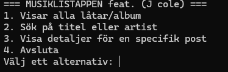

# Musiklistappen — Max Svensson

---

## Vad appen gör

Musiklistappen innehåller information om J. Cole, hans låtar, album och medverkande artister.
Via huvudmenyn kan användaren visa alla låtar, söka efter låt eller artist och visa
detaljerad information om låtar, album och artister.

## Så kör du den

```bash
git clone https://github.com/Maxswe99/max-clo26-musiklistappen.git
cd max-clo26-musiklistappen/MusikApp
dotnet run
```

Databasen `musik.db` ska ligga i mappen `MusikApp/`. Om `appsettings.json`
saknas, kopiera `appsettings.example.json` och döp kopian till `appsettings.json`.

## Så ser huvudmenyn ut



## Mina designval

Databasen är uppdelad i tabeller för låtar, album och artister. Det minskar
duplicerad information och gör relationerna mellan låtar, album och artister
tydliga.

Jag använder `JOIN` i appen för att hämta information från flera tabeller i
samma fråga. Det passar appen eftersom en låt ska visas tillsammans med sitt
album och sin artist.